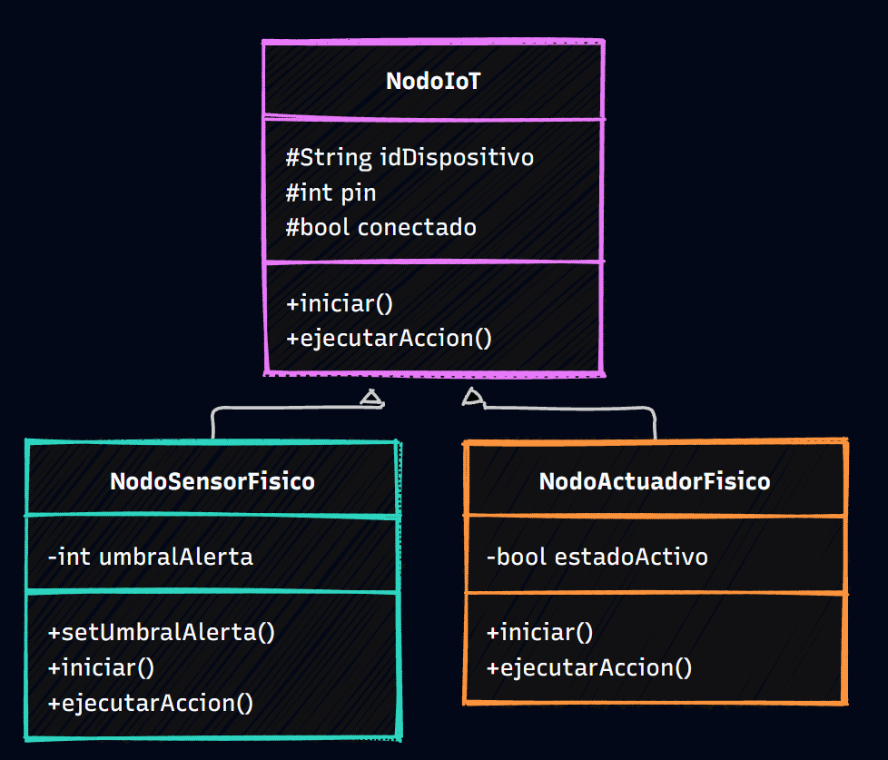
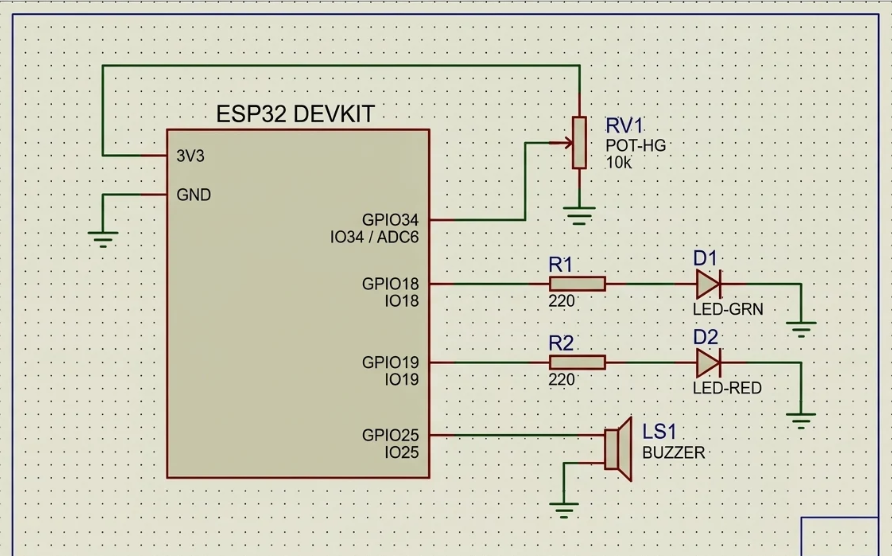

# Reporte de Práctica de Laboratorio — Programación Orientada a Objetos

## EE: Temas Selectos de IIE II (Código: IEDI 18005)

## Facultad de Instrumentación Electrónica — Universidad Veracruzana

---

## Información General del Equipo

- **Número de Práctica:** Práctica 3
- **Título de la Práctica:** Implementación Física de Nodos IoT Heterogéneos en C++ (ESP32)
- **Fecha de Entrega:** [27/11/2026]
- **Enlace al Repositorio de GitHub:** https://github.com/AndreVg4/POO_Equipo5

| Nombre Completo del Integrante | Matrícula UV | Usuario de GitHub |
| :--- | :--- | :--- |
| Andre Vega Morales | S22013537 | @AndreVg4 |
| Ricardo Abraham Sosa Calvario | S22013518 | @RicardoS22 |
| Isaac Vazquez Carrizo | S22013542 | @IsaacVzC |
| Eduardo Ramos Mateos | S22013532 | @Eduardo-Ramoss |

---
---

# Sección 1: Abstracción de Hardware a POO (Mapeo de Clases)

Esta práctica tuvo como objetivo implementar una arquitectura de nodos IoT heterogéneos sobre una tarjeta ESP32 utilizando Programación Orientada a Objetos en C++. Para ello se diseñó una jerarquía de clases compuesta por una superclase denominada `NodoIoT` y dos subclases derivadas: `NodoSensorFisico` y `NodoActuadorFisico`.

## 1.1 Diagrama de Clases UML



---

## 1.2 Mapeo de Atributos (Características Físicas ➔ Variables de Clase)

### Clase NodoIoT

- **idDispositivo:** Identifica de forma única cada dispositivo físico conectado al ESP32.
- **pin:** Almacena el GPIO utilizado para la conexión física del hardware.
- **conectado:** Indica si el nodo fue inicializado correctamente.

### Clase NodoSensorFisico

- **umbralAlerta:** Valor límite utilizado para determinar condiciones de alerta.
- **ultimaLectura:** Guarda el último valor obtenido desde el convertidor ADC del ESP32.

### Clase NodoActuadorFisico

- **estadoActivo:** Representa el estado actual del actuador físico (encendido o apagado).

---

## 1.3 Mapeo de Métodos (Acciones del Hardware ➔ Funciones Miembro)

### Clase NodoIoT

- **iniciar():** Configura los recursos de hardware asociados al nodo.
- **ejecutarAccion():** Método virtual utilizado para implementar comportamiento polimórfico.

### Clase NodoSensorFisico

- **setUmbralAlerta():** Permite establecer un valor de alerta validando que permanezca dentro del rango del ADC.
- **getLectura():** Retorna la lectura más reciente obtenida por el sensor.
- **ejecutarAccion():** Realiza una lectura analógica mediante `analogRead()` y envía la información al monitor serie.

### Clase NodoActuadorFisico

- **setEstado():** Modifica el estado lógico del actuador.
- **ejecutarAccion():** Actualiza físicamente el estado del hardware mediante `digitalWrite()`.

---

# Sección 2: Bitácora de Depuración y Errores (Bug Log)

| # | Falla Física o Lógica Detectada | Causa Raíz (Hardware / Software) | Solución Técnica Implementada |
|---|---|---|---|
| 1 | Las lecturas del sensor variaban de forma inesperada durante las primeras pruebas. | Conexiones inestables en la protoboard y sensibilidad propia de la entrada analógica. | Se revisaron las conexiones físicas, se corrigió el cableado y se ajustó el umbral de alerta. |
| 2 | Los LEDs no respondían al valor leído por el sensor. | Los pines de salida no estaban configurados correctamente antes de utilizar `digitalWrite()`. | Se implementó la inicialización de los pines dentro del método `iniciar()` de la clase `NodoActuadorFisico`. |

---

# Sección 3: Justificación del Diseño Orientado a Objetos

## Herencia y Reutilización de Código

Sí se utilizó herencia.

La superclase diseñada fue:

```text
NodoIoT
```

A partir de ella se derivaron las clases:

```text
NodoSensorFisico
NodoActuadorFisico
```

Esta estructura permitió reutilizar atributos y comportamientos comunes como el identificador del dispositivo, el pin de conexión y el estado de conectividad, evitando duplicación de código y facilitando el mantenimiento del proyecto.

---

## Polimorfismo

El polimorfismo se implementó mediante el método virtual:

```cpp
ejecutarAccion()
```

Cada subclase proporciona una implementación específica:

- `NodoSensorFisico` realiza lecturas analógicas mediante `analogRead()`.
- `NodoActuadorFisico` controla dispositivos de salida utilizando `digitalWrite()`.

Todos los dispositivos son gestionados mediante un arreglo de punteros a la clase base:

```cpp
NodoIoT* red[4];
```

Lo anterior permite invocar:

```cpp
red[i]->ejecutarAccion();
```

sin necesidad de conocer el tipo específico de cada nodo.

---

## Encapsulamiento y Ocultamiento de Datos

Para proteger la integridad de los datos se utilizaron atributos privados.

### NodoSensorFisico

```cpp
private:
    int umbralAlerta;
    int ultimaLectura;
```

### NodoActuadorFisico

```cpp
private:
    bool estadoActivo;
```

El acceso a dichos atributos se realiza exclusivamente mediante métodos públicos controlados:

```cpp
setUmbralAlerta()
getLectura()
setEstado()
```

De esta manera se garantiza la validez de la información utilizada por cada objeto y se evita la modificación directa de variables críticas.

---

# Sección 4: Evidencias de Funcionamiento (Validación Dual)

## 4.1 Captura de Pantalla de la Terminal / Monitor Serial

**[INSERTAR AQUÍ CAPTURA DEL MONITOR SERIAL]**

Ejemplo de salida observada:

```text
RED IOT INICIADA

SENSOR_ADC: 1050
NORMAL

----------------

SENSOR_ADC: 3250
ALERTA

----------------
```

---

## 4.2 Fotografía del Circuito Físico Armado

**[INSERTAR AQUÍ FOTOGRAFÍA DEL CIRCUITO FÍSICO]**

La imagen debe mostrar:

- ESP32.
- Protoboard.
- Potenciómetro conectado al GPIO34.
- LED Verde conectado al GPIO18.
- LED Rojo conectado al GPIO19.
- Buzzer conectado al GPIO25.
- Hoja escrita a mano con:
  - Fecha.
  - Número de práctica.
  - Matrículas de los integrantes.

---

## 4.3 Diagrama de Conexiones del Circuito



### Conexiones utilizadas

```text
Potenciómetro
├── VCC → 3.3V
├── GND → GND
└── Señal → GPIO34

LED Verde
├── Ánodo → GPIO18
└── Cátodo → GND (con resistencia)

LED Rojo
├── Ánodo → GPIO19
└── Cátodo → GND (con resistencia)

Buzzer
├── Positivo → GPIO25
└── Negativo → GND
```

---

## 4.4 Enlace Directo al Video Demostrativo

**Enlace de Visualización:**

[PEGAR AQUÍ EL ENLACE DEL VIDEO]


---

# Conclusiones

Durante esta práctica se implementó una red de nodos IoT heterogéneos utilizando Programación Orientada a Objetos en C++ sobre una tarjeta ESP32. Se aplicaron los conceptos de herencia mediante una clase base común, encapsulamiento mediante atributos privados y polimorfismo a través de métodos virtuales. Asimismo, se validó la integración entre software y hardware mediante la lectura de un sensor analógico y el control de múltiples actuadores físicos en tiempo real.
