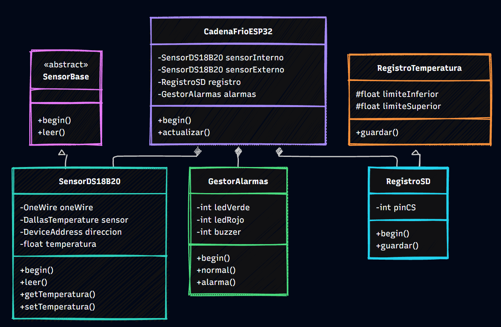
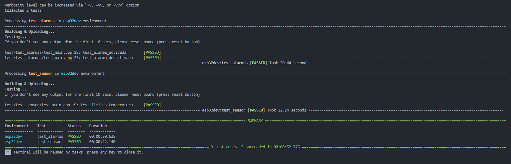

# Universidad Veracruzana

## Facultad de Instrumentación Electrónica

# Proyecto Integrador ESP32

## Monitoreo de Cadena de Frío para Productos Farmacéuticos y Perecederos

### EE: Temas Selectos de IIE II (Código: IEDI 18005)

# Etapa 2 – Desarrollo Modular y Programación Orientada a Objetos

---

## Información General del Equipo

- **Número de Práctica:** Proyecto Integrador – Etapa 2
- **Título de la Práctica:** Implementación de Arquitectura Orientada a Objetos para un Sistema de Monitoreo de Cadena de Frío
- **Fecha de Entrega:** 21/11/2026
- **Enlace al Repositorio de GitHub:** https://github.com/AndreVg4/POO_Equipo5

| Nombre Completo del Integrante | Matrícula UV | Usuario de GitHub |
| :--- | :--- | :--- |
| Andre Vega Morales | S22013537 | @AndreVg4 |
| Ricardo Abraham Sosa Calvario | S22013518 | @RicardoS22 |
| Isaac Vazquez Carrizo | S22013542 | @IsaacVzC |
| Eduardo Ramos Mateos | S22013532 | @Eduardo-Ramoss |

---

# Sección 1: Mapeo de Abstracción (Hardware ➜ POO)

En esta etapa se implementó una arquitectura orientada a objetos donde cada componente físico del sistema fue representado mediante clases especializadas. El objetivo fue abstraer la funcionalidad del hardware para mejorar la modularidad, reutilización y mantenimiento del software.

---

## 1.1 Diagrama de Clases UML




### UML Implementado

```text
                    +----------------------+
                    |      SensorBase      |
                    | <<abstract>>         |
                    +----------------------+
                    | + begin()            |
                    | + leer()             |
                    +----------^-----------+
                               |
                               |
                     +---------+--------+
                     | SensorDS18B20    |
                     +------------------+
                     | - direccion      |
                     | - temperatura    |
                     +------------------+

                    +----------------------+
                    | RegistroTemperatura  |
                    +----------------------+
                    | + guardar()          |
                    +----------^-----------+
                               |
                               |
                        +------+------+
                        | RegistroSD  |
                        +-------------+

                    +----------------------+
                    | GestorAlarmas        |
                    +----------------------+

                    +----------------------+
                    | CadenaFrioESP32      |
                    +----------------------+
```

---

## 1.2 Mapeo de Atributos (Características Físicas ➜ Variables de Clase)

### Clase SensorDS18B20

Esta clase representa físicamente cada uno de los sensores DS18B20 conectados al bus OneWire.

#### Atributos

```cpp
private:

OneWire oneWire;

DallasTemperature sensor;

DeviceAddress direccion;

float temperatura;
```

| Atributo | Correspondencia Física |
|-----------|----------------------|
| oneWire | Bus físico OneWire utilizado para la comunicación |
| sensor | Instancia que controla el protocolo de comunicación del DS18B20 |
| direccion | Dirección ROM única de 64 bits grabada por fábrica en el sensor |
| temperatura | Valor medido por el sensor físico |

---

### Clase GestorAlarmas

Esta clase representa los actuadores físicos del sistema.

#### Atributos

```cpp
private:

int ledVerde;

int ledRojo;

int buzzer;
```

| Atributo | Correspondencia Física |
|-----------|----------------------|
| ledVerde | GPIO conectado al LED verde |
| ledRojo | GPIO conectado al LED rojo |
| buzzer | GPIO conectado al buzzer |

---

### Clase RegistroSD

Esta clase representa el módulo MicroSD.

#### Atributos

```cpp
private:

int pinCS;
```

| Atributo | Correspondencia Física |
|-----------|----------------------|
| pinCS | Pin Chip Select del módulo SD |

---

## 1.3 Mapeo de Métodos (Acciones del Hardware ➜ Funciones Miembro)

### Clase SensorDS18B20

#### Método begin()

```cpp
begin();
```

Inicializa la comunicación con el sensor físico.

---

#### Método leer()

```cpp
leer();
```

Solicita una conversión de temperatura al dispositivo físico y recupera la medición utilizando su dirección ROM.

---

### Clase GestorAlarmas

#### Método normal()

```cpp
normal();
```

Activa el LED verde y desactiva los indicadores de alarma.

---

#### Método alarma()

```cpp
alarma();
```

Activa el LED rojo y el buzzer para indicar una condición fuera de rango.

---

### Clase RegistroSD

#### Método guardar()

```cpp
guardar();
```

Escribe los datos adquiridos dentro de un archivo CSV almacenado en la memoria MicroSD.

---

## Aplicación del Encapsulamiento

Los datos adquiridos desde el hardware son almacenados como atributos privados para evitar modificaciones externas directas.

Ejemplo:

```cpp
private:

float temperatura;

DeviceAddress direccion;
```

El acceso se realiza únicamente mediante métodos públicos como:

```cpp
getTemperatura();

setTemperatura();
```

protegiendo la integridad de los datos antes de ser utilizados por otras partes del sistema.

---

# Sección 2: Bitácora de Depuración y Errores (Bug Log)

| # | Falla Física o Lógica Detectada | Causa Raíz | Solución Técnica Implementada |
|---|--------------------------------|------------|-------------------------------|
| 1 | Los sensores DS18B20 devolvían valores de -127 °C. | El bus OneWire no detectaba correctamente los dispositivos debido a problemas de conexión y resistencia Pull-Up. | Se verificó el cableado y se instaló correctamente la resistencia Pull-Up de 4.7 kΩ entre DATA y VCC. |
| 2 | Ambos sensores mostraban exactamente la misma temperatura. | Los dos objetos utilizaban `getTempCByIndex(0)`, por lo que ambos consultaban el mismo sensor del bus. | Se identificaron las direcciones ROM individuales y se implementó lectura mediante `DeviceAddress`. |
| 3 | Error de compilación asociado a ConfigHardware.h. | El archivo de configuración no era visible desde la librería principal. | Se reorganizó la estructura de carpetas y se reubicó el archivo dentro del módulo correspondiente. |

---

# Sección 3: Justificación del Diseño Orientado a Objetos

## Herencia y Reutilización de Código

### ¿Utilizaron herencia en el proyecto?

Sí.

La superclase implementada es:

```cpp
SensorBase
```

La subclase derivada es:

```cpp
SensorDS18B20
```

La utilización de herencia permite definir una interfaz común para futuros sensores sin necesidad de duplicar código. Cualquier sensor adicional podrá reutilizar los métodos de inicialización y lectura definidos por la clase base.

---

## Polimorfismo

### ¿Cómo implementaron comportamientos con múltiples formas?

Se implementó mediante la clase:

```cpp
RegistroTemperatura
```

que define el método virtual:

```cpp
virtual bool guardar(String dato)=0;
```

Posteriormente, la clase:

```cpp
RegistroSD
```

implementa dicho método de forma específica para almacenamiento en MicroSD.

Esto permite que futuras alternativas de almacenamiento puedan reutilizar la misma interfaz sin modificar el resto del código.

---

## Encapsulamiento y Ocultamiento de Datos

Los atributos relacionados con la lectura y control de hardware fueron declarados como privados para proteger la integridad de la información.

Ejemplo:

```cpp
private:

float temperatura;

DeviceAddress direccion;

OneWire oneWire;
```

El acceso a dichos atributos se realiza mediante métodos públicos controlados:

```cpp
getTemperatura();

setTemperatura();
```

De esta forma se evita la modificación accidental de valores críticos utilizados por el sistema.

---

# Sección 4: Evidencias de Funcionamiento (Validación Dual)

---

## 4.1 Captura de Pantalla de la Terminal / Monitor Serial

Insertar captura de pantalla del monitor serial mostrando lecturas reales del sistema.

Ejemplo obtenido durante las pruebas:

```text
Interna: 7.12
Externa: 23.56
```

Estas lecturas demuestran el correcto funcionamiento de los dos sensores identificados mediante direcciones ROM independientes y la diferenciación entre temperatura interna y temperatura ambiente.


---

## 4.2 Fotografía del Circuito Físico Armado (Garantía de Autoría)

### Circuito:


---

## 4.3 Enlace Directo al Video Demostrativo

**Enlace de Visualización:**

```text
https://drive.google.com/drive/folders/1fDfR6xdwayzvqFSVagemJzNCmPqPt8Jg?usp=sharing
```


---

# Pruebas Unitarias

Se desarrollaron pruebas unitarias utilizando el framework Unity integrado en PlatformIO.

Resultados obtenidos:

```text
3 test cases: 3 succeeded
```

Pruebas ejecutadas:

- test_limites_temperatura
- test_alarma_activada
- test_alarma_desactivada

Todos los casos de prueba fueron ejecutados satisfactoriamente.


### Caprtura de la terminal:



---


# Conclusiones

Se implementó una arquitectura orientada a objetos para el sistema de monitoreo de cadena de frío utilizando ESP32 y sensores DS18B20. La aplicación de herencia, encapsulamiento y polimorfismo permitió desarrollar una solución modular, escalable y mantenible.

Asimismo, se validó el funcionamiento mediante pruebas unitarias y pruebas físicas sobre hardware real, consiguiendo diferenciar correctamente la temperatura interna del sistema refrigerado y la temperatura ambiente externa.
